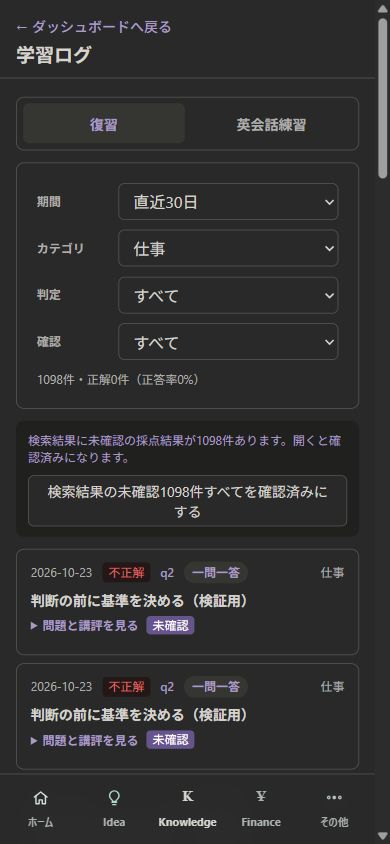
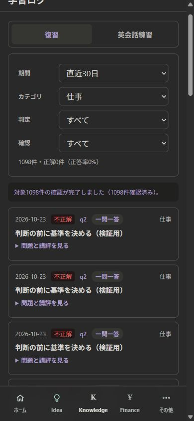
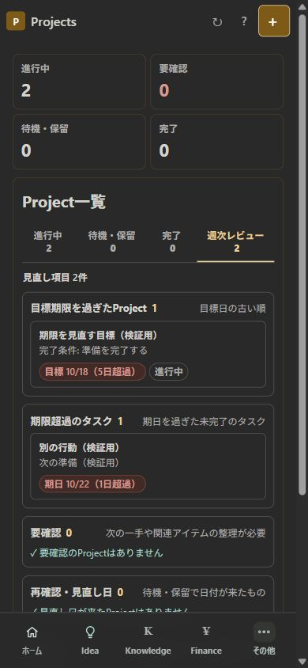
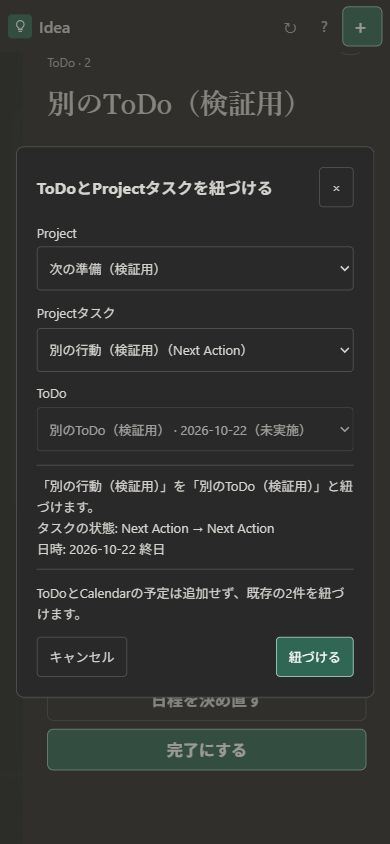
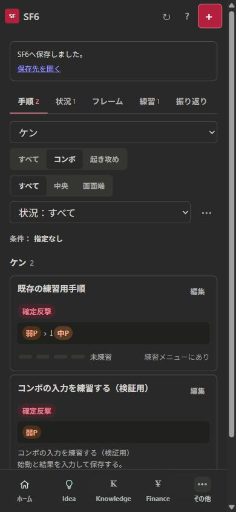
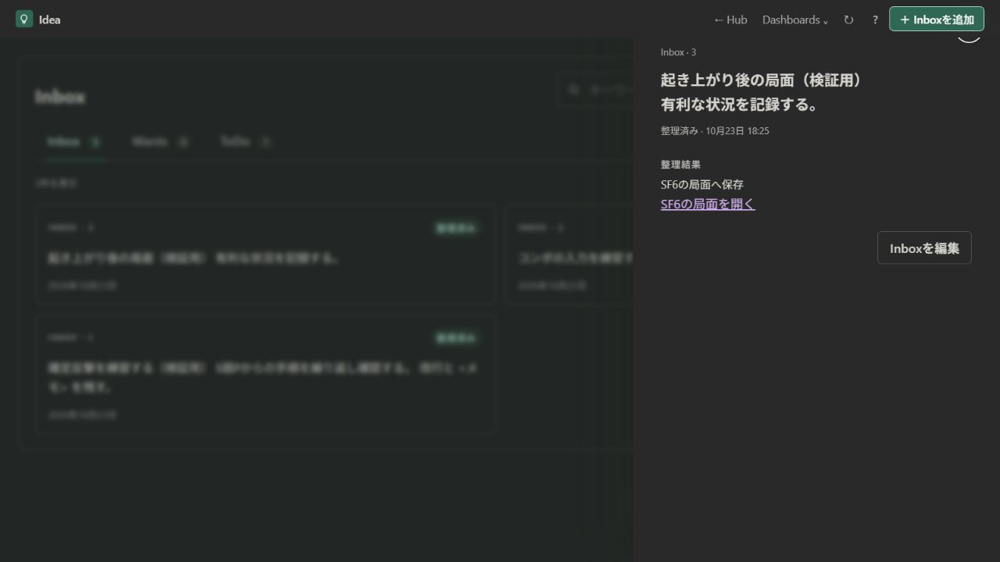

# Issue #230–#233 最終レビュー

2026-10-23、エージェント④。対象は今回承認された4件のみ。設計①→既存仕様レビュー②→実装③→独立レビュー④の順で確認した。実装・ローカル検証は完了。本番DBへのmigration適用、本番公開、Issueのクローズは未実施。

## 役割とレビュー結果

| 担当 | 成果物・結果 |
| --- | --- |
| ① 仕様から設計 | [設計書](../design/production-review-230-233.md)。対象範囲、状態・日付の管理元、API/DB、受け入れ条件を具体化 |
| ② 既存仕様と照合 | 同設計書8章。最大1 Next、Calendarの取消、旧RPC、reloadの失敗処理、SF6の原文保持・再送の衝突を設計へ反映 |
| ③ 実装 | 既存の確認API、Project操作、SF6フォーム/validator/手順保存RPCを再利用。共通処理を小さなモジュールへ分離 |
| ④ 独立レビュー | ソース/差分、実PostgreSQL、実Functionsハンドラー、PC/390px画面を照合。下記2件を修正後に再確認。未解決の実装指摘なし |

④が発見・修正を確認した点:

- #231の期限超過行でProject名が2回表示されていた。補助行を完了条件へ変更し、他のレビュー欄の表示は維持した。
- #232/#233の相互リンクが、既存の「完了済みなら一覧へ戻す」処理に遮られていた。明示的な履歴参照リンクだけ完了ToDo/整理済みInboxを直接開く。通常のHub/Todayリンク、Wants、アーカイブの既存挙動は維持した。共通URL生成・解析と回帰テストを追加し、実画面で双方を確認した。

## 受け入れ条件と証拠

| Issue | 確認した結果 | 主な証拠 |
| --- | --- | --- |
| #230 全ページの未確認結果 | 30件表示でも検索条件に合う1,098件を対象とする。3回目の送信を失敗させた400件成功後、残り698件のみ再実行し、全件再取得で1,098件の完了を確認。条件外6件と確認済み6件を初回対象から除外。二重実行・再取得失敗・採点/習得度/復習予定の不変も確認 | `reviewConfirmation.test.ts`、`todayLearning.test.ts`、[実DB/API結果](evidence-230-233/audit-230-233-results.json)、下記画面 |
| #231 Project目標期限 | JSTの昨日以前かつ進行中/待機/保留だけ表示。今日/未来/未設定/完了/取りやめを除外し、期限の古い順。詳細を開け、再読込で再計算。既存のタスク期限等を維持し、合計は「見直し項目」と表記 | `projectTargetReview.test.ts`、PC/390pxの週次レビュー操作 |
| #232 既存ToDoとAction | 両画面から手動選択、確認後だけ1対1リンク。キャンセルは変更なし。ToDo→完了→次のAction選択と、Project→完了→Project完了の両経路で連動を確認。CalendarイベントID/ETagを維持。解除は両記録・Action保存済み日付を保持。完了済み相互リンクも開ける | `projectActionTodos.test.ts`、`scheduledActions.test.ts`、`compassRouting.test.ts`、[実DB結果](evidence-230-233/audit-232-results.json)、PC/390px操作 |
| #233 Inbox→SF6 | 局面/コンボ/練習を実画面から保存。コンボ↔起き攻めのフォーム切替、原文と改行、キャンセル時pending維持を確認。DBでは起き攻めを含む全3resourceの原子的保存、再送、競合、ロールバック、削除後の再作成抑止を確認。保存後のSF6→整理済みInbox→SF6の往復も確認 | `inboxSf6.test.ts`、既存`sf6.test.ts`/`inboxRouting.test.ts`、[実DB/API結果](evidence-230-233/audit-230-233-results.json)、PC/390px操作 |

テストの参照先は`apps/hub/tests/`、Knowledge分は`apps/knowledge/tests/`。

## 実行した検査

- 全822テスト成功（共有認証22、Hub421、Knowledge306、Finance73）。失敗/スキップ0。
- 全workspace型チェック、Hubクライアント検査、3アプリのtheme整合検査が成功。
- 3アプリの通常buildとHub/KnowledgeのPages Functions buildが成功。履歴リンク修正後にHubのbuild・型・クライアント検査、全822テストを再実行した。
- 新migration2件を、既存23件のアプリmigrationを適用した使い捨てPostgreSQLへ実際に適用。アプリ表/制約/RPCを省略していない。Calendarのcron/pg_net/Vaultによる外部スケジュール設定だけをローカルfixtureから除外した。
- PostgreSQL 18.4の別接続による実並行処理も実行した。36検証グループが成功し、そのうち下記100組の並行実行で重複、片側だけの保存、deadlockを検出しなかった。先行処理後にもう一方も成功できる場合は、正しい直列実行と同じ結果になることを判定した。

| 並行処理 | 実行数 |
| --- | ---: |
| 同一ToDoに2つのリンク | 20組 |
| リンク済み完了と解除 | 20組 |
| Calendar取消とリンク | 20組 |
| マイルストン削除とリンク済みAction完了 | 20組 |
| 同じInboxを異なるキーでSF6保存 | 10組 |
| 異なるInboxを同じキーでSF6保存 | 10組 |

実DBでは、Nextの完了/見送りそれぞれについて「続ける/Project完了/待機/保留」、再開、古いsnapshot/旧RPCからの更新拒否、匿名roleからのアクセス拒否も実行した。Knowledgeは実際の確認APIハンドラーと既存`confirm_review_results` SQLを接続して実行した。

[導入用の読み取り専用SQL検査](evidence-230-233/release-sql-check.json)も同じ実DBで成功した。権限等のbooleanは全てtrue、状態が不整合のリンクと複数NextのProjectはいずれも0件。

検証したmigrationのSHA-256:

- `202610230001_project_action_todos.sql`: `a1de5bb78b1f6b9a1501ca9f0863688ca18909443db8d9405eefd1336b60c5ca`
- `202610230002_inbox_sf6_routes.sql`: `d4b32dcb69b64ac378c73aeb199cc5b6a140668c7ccc7e102f8d5fc54542a94e`

生の結果JSONに同じhashと各検証名を保存した。実行時の監査スクリプト・標準出力・HTTP記録はローカル作業記録`C:/GitTest/.tmp/approved-review-issues-20261023/`へ保存した。通常の回帰テストと導入用SQL検査はリポジトリ内にある。

## 画面確認の記録

画面はすべて合成データを使用したローカル検証。390px幅のiframe内で実際のアプリを操作し、PCの通常画面と併せて確認した。横方向のはみ出しは検出していない。

| 全件処理の前 | 全1,098件完了 |
| --- | --- |
|  |  |

| 週次レビュー | 手動リンクの確認 | SF6保存後 |
| --- | --- | --- |
|  |  |  |

## AI側で判断した仕様

1. 「全件」は実行開始時の検索条件に合う未確認ID集合で固定する。実行中の新しい結果を追加せず、表示ページ数とも連動させない。途中成功は保持し、最新状態を取得できない間は全件完了と断定しない。
2. 週次レビュー件数は既存どおり各見直し理由の項目数を合算する。同じProjectの複数理由を1件へまとめず、ラベルで意味を明確にする。
3. リンクは利用者が確認した既存2件だけに作る。日時はCalendar/ToDoの予定、実施状態はToDoを管理元とし、Projectの保存済み日付は解除後に戻せるよう残す。
4. Nextを完了/見送りにするときは、次のActionかProjectの扱いを必ず一緒に決める。最大1 Nextを維持し、終了済みProjectの架空の再開操作は追加しない。
5. 状態連動はDBで一括処理し、古い画面から片側だけ更新できないようにする。Calendar取消時はリンク済みToDoと、既存の予定履歴を持つToDoを保持し、参照切れ/外部キーによる処理失敗を避ける。
6. SF6メモからキャラ・技・フレーム値を推測して確定しない。既存フォームに原文を渡し、不足項目は利用者が入力する。SF6保存とInbox完了は同一transactionで行い、削除後も同じ再送で作り直さない。
7. 今回の相互リンクは終了済みの記録を参照する用途もあるため、共通の明示的履歴リンクを追加した。通常の古い通知リンクやアーカイブの扱いまで広げない。

## 検証範囲と公開時の注意

- 本番Supabase、実Google Calendarへの書込、実データの一括確認は実施していない。Googleとのネットワーク往復と本番の認証/権限/既存データへの適用は、公開時に別途確認する。
- ローカルHTTP統合は実ハンドラーと実SQLを使い、Supabase RESTの通信部分だけをfixture adapterへ置き換えた。Supabase拡張のスケジューラー自体の稼働証明ではない。
- 解除の保存・原本保持・競合はAPI/実DBで検証済み。内蔵ブラウザーが標準確認ダイアログの確定を操作できなかったため、解除の確認画面を承認する操作は自動画面検証の範囲外とした。新規リンクの保存/キャンセルと両方向の完了は画面から検証済み。
- [導入・切り戻し手順](../../apps/hub/docs/production-review-230-233-release.md)に従いDBを先に更新する。旧UIへ戻す場合も関連表と記録を残し、リンク済みの状態を確認する。本番の適用確認後にIssueをクローズする。
